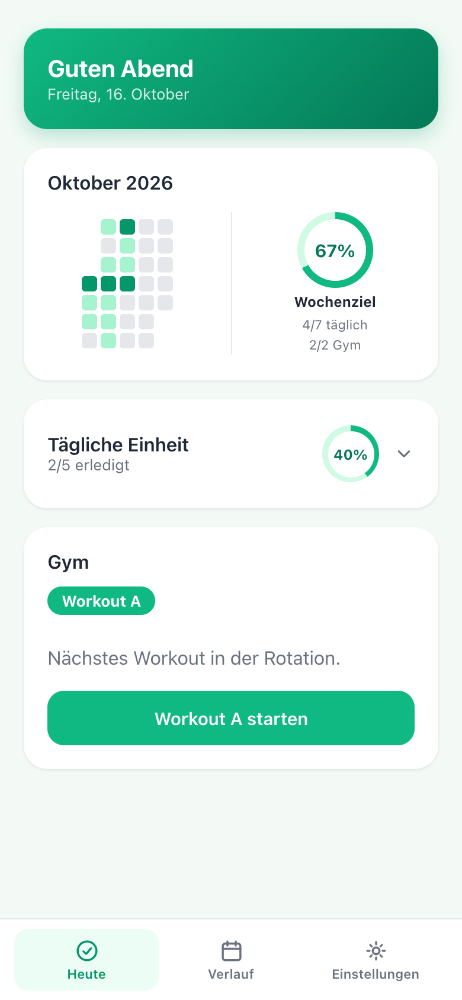
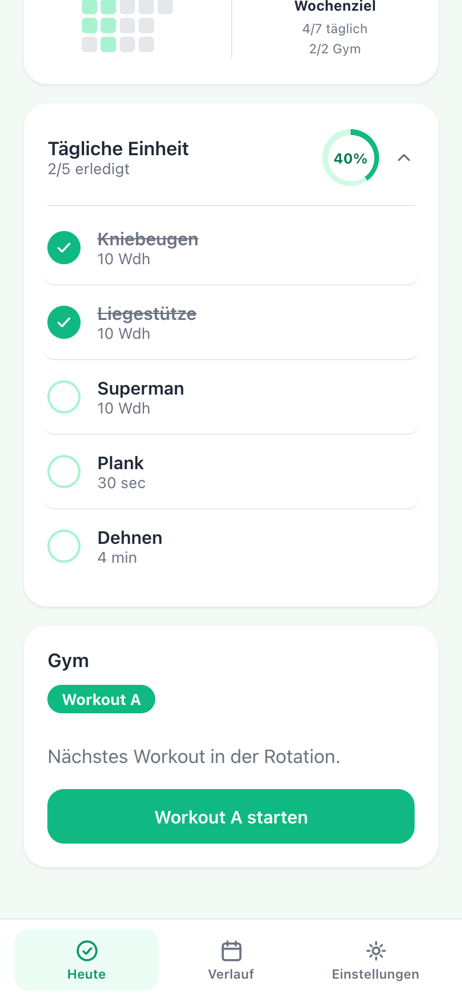
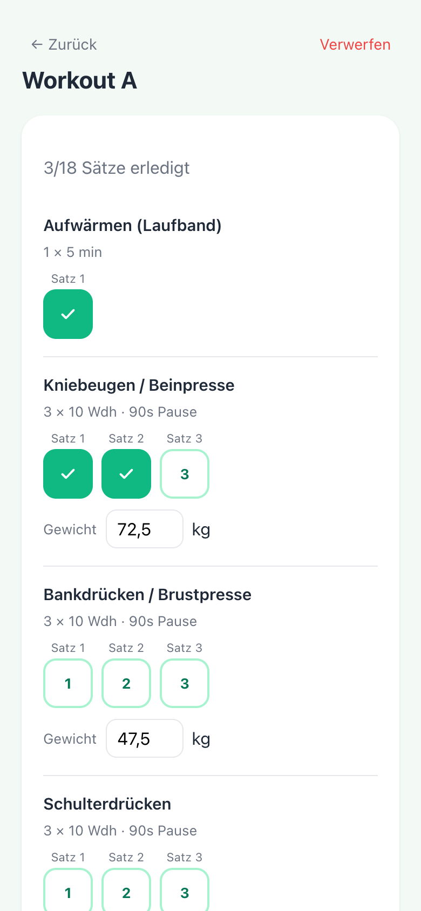
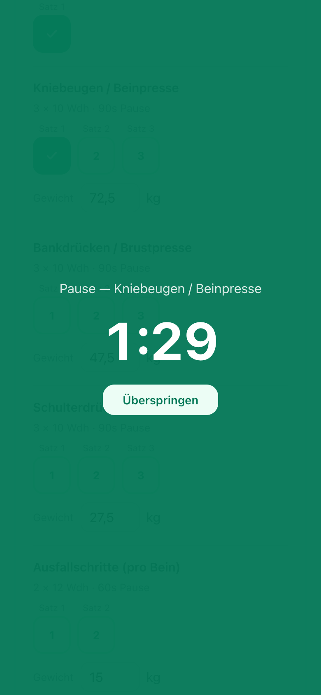
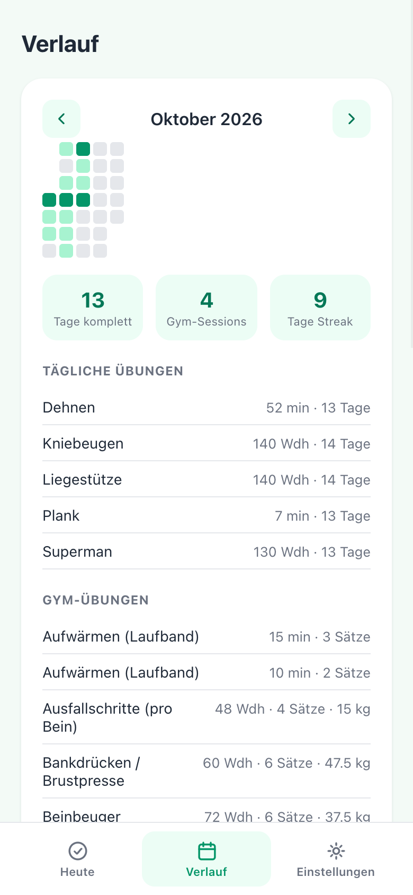
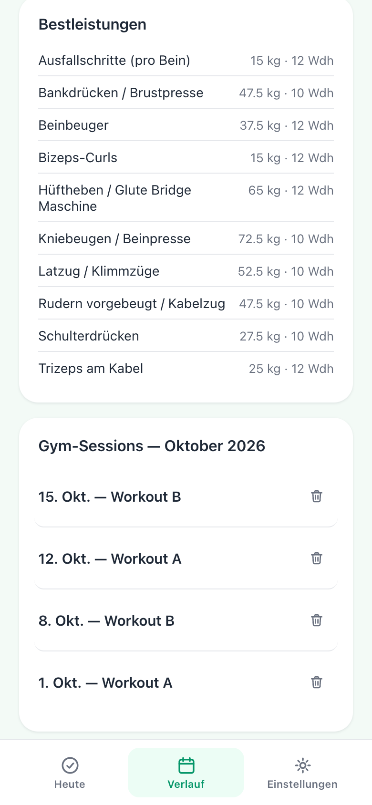
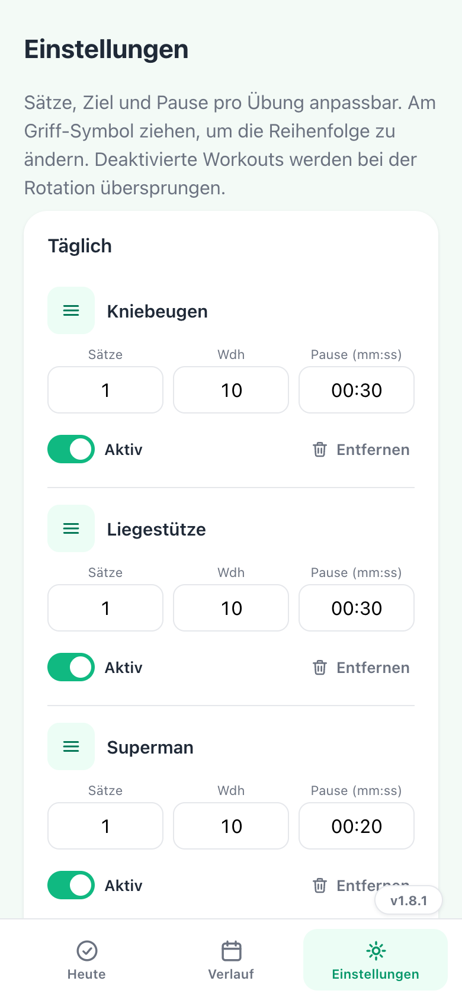
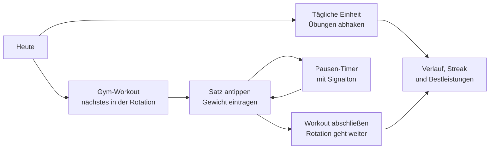
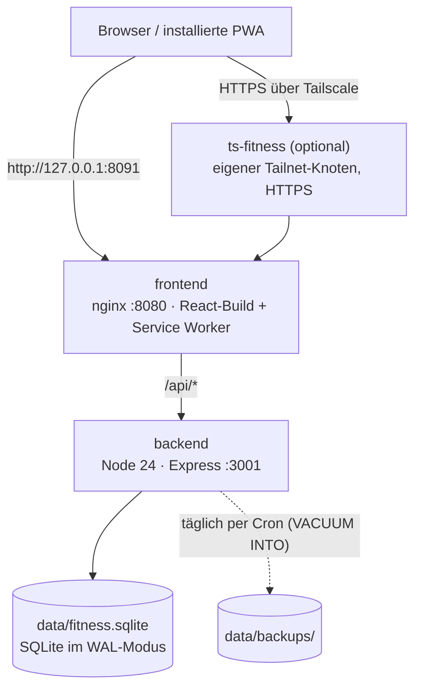

# Fitness-PWA

[](https://github.com/Guppy997/fitness-pwa/actions/workflows/ci.yml)


> **In short (English):** A self-hosted workout tracker as an installable web app. Tick off a short daily routine, and run gym workouts in rotation with set tracking, remembered weights and a rest timer. Runs on your own hardware, no account, no tracking, no external services. The interface is in German.

**Fitness-Tracker** ist eine selbst gehostete Trainings-App als installierbare Web-App. Jeden Tag eine kurze Einheit zum Abhaken, dazu Gym-Workouts im Wechsel mit Satz-Tracking, Gewichten und Pausen-Timer. Läuft komplett auf eigener Hardware (bei mir ein Raspberry Pi 5), ohne Konto, ohne Tracking und ohne externe Dienste.

<table>
  <tr>
    <td align="center" width="25%"><br><sub>Heute</sub></td>
    <td align="center" width="25%"><br><sub>Tägliche Einheit</sub></td>
    <td align="center" width="25%"><br><sub>Gym-Workout</sub></td>
    <td align="center" width="25%"><br><sub>Pausen-Timer</sub></td>
  </tr>
  <tr>
    <td align="center"><br><sub>Verlauf</sub></td>
    <td align="center"><br><sub>Bestleistungen</sub></td>
    <td align="center"><br><sub>Einstellungen</sub></td>
    <td></td>
  </tr>
</table>

<sub>Screenshots mit Demo-Daten (siehe <a href="#mit-demo-daten-ausprobieren">Mit Demo-Daten ausprobieren</a>). Aktuelle Version: 1.8.1.</sub>

## Inhalt

- [Im Einsatz](#im-einsatz)
- [So funktioniert's](#so-funktionierts)
- [Funktionen](#funktionen)
- [Architektur](#architektur)
- [Sicherheit und Datenschutz](#sicherheit-und-datenschutz)
- [Selbst hosten](#selbst-hosten)
- [Backup und Wiederherstellung](#backup-und-wiederherstellung)
- [Entwicklung](#entwicklung)
- [Releases und Versionen](#releases-und-versionen)
- [Projektstruktur](#projektstruktur)
- [API](#api)
- [Datenmodell](#datenmodell)
- [Grenzen und Ideen](#grenzen-und-ideen)
- [Entstehung](#entstehung)
- [Lizenz](#lizenz)

## Im Einsatz

Die App läuft seit Version 1.0.0 im Juli 2026 auf meinem Raspberry Pi 5 und ist dort für mein eigenes Training in Benutzung.

## So funktioniert's



1. **Täglich:** Eine kurze Einheit, standardmäßig Kniebeugen, Liegestütze, Superman, Plank und Dehnen, wird einfach abgehakt.
2. **Gym:** Die App schlägt das nächste Workout der Rotation vor (A → B → A …). Jeder Satz wird angetippt, das Gewicht pro Übung gemerkt, und danach startet automatisch die Pause.
3. **Überblick:** Monats-Heatmap, Wochenziel, Streak, Monatssummen und Bestleistungen zeigen, wie es läuft.

## Funktionen

**Heute**
- Begrüßung mit Datum, die **Monats-Heatmap** des aktuellen Monats und ein **Wochenziel-Ring**. Das Ziel lautet jeden Tag die tägliche Einheit und 2× Gym pro Woche (Mo–So), also 9 Einheiten pro Woche.
- **Tägliche Einheit** mit Fortschrittsring, standardmäßig eingeklappt. Ein Tipp zeigt die Übungen zum Abhaken.
- Die Optionen Glute Bridge und Nacken-/Schulterkreisen sind standardmäßig aus und lassen sich in den Einstellungen dazuschalten.

**Gym**
- **Rotation:** Die App schlägt immer das nächste aktive Workout vor. Deaktivierte Workouts werden übersprungen. Ist nur eines aktiv, bleibt es immer dasselbe.
- **Standard-Workouts:** A (Push & Beine) und B (Pull & Ausdauer), beide mit Laufband-Aufwärmen am Anfang und Dehnen am Ende. Eigene Workouts, zum Beispiel C, lassen sich dazu anlegen.
- **Sätze antippen** zum Abhaken, nochmal tippen macht den Satz rückgängig. Das Gewicht wird pro Übung eingetragen, die App merkt sich den letzten Wert für das nächste Training.
- **Pausen-Timer:** Er startet nach jedem Satz automatisch mit der eingestellten Pause, gibt am Ende einen Signalton und lässt sich überspringen.
- Ein versehentlich gestartetes Workout lässt sich verwerfen, abgeschlossene Workouts im Verlauf löschen.

**Verlauf**
- Monat zum Durchblättern: Kalender-Heatmap, komplette Tage, Gym-Sessions und Streak.
- **Monatssummen pro Übung**, zum Beispiel alle Liegestütze des Monats.
- **Bestleistungen:** das höchste je eingetragene Gewicht pro Gym-Übung.

**Einstellungen**
- Pro Übung Sätze, Ziel (Wiederholungen oder Zeit als mm:ss) und Pause anpassen sowie aktivieren oder deaktivieren.
- Eigene Übungen hinzufügen oder entfernen, Reihenfolge per Drag & Drop am Griff-Symbol.
- Workouts anlegen, deaktivieren und löschen. Der Verlauf gelöschter Workouts bleibt erhalten.

**App**
- Als **PWA** auf dem Handy installierbar.
- **Offline:** Ist der Server nicht erreichbar, zeigt die App den zuletzt bekannten Stand.
- **Update-Hinweis:** Liegt eine neue Version auf dem Server, erscheint in den Einstellungen „Update verfügbar“. Dort stehen auch Versionsnummer und Versionsverlauf.

## Architektur



| Teil | Technik |
|---|---|
| Frontend | React 18, Vite 5, `vite-plugin-pwa` (Manifest, Service Worker, NetworkFirst-Cache für `GET /api/*`) |
| Backend | Node 24, Express 4, better-sqlite3. Kein ORM, alle Queries parametrisiert |
| Datenbank | SQLite im WAL-Modus, Foreign Keys an, Schema und Standard-Übungen werden beim ersten Start angelegt (`backend/src/db.js`) |
| Betrieb | Docker Compose, beide Container non-root, mit Healthchecks und Ressourcen-Limits |
| Zugriff | Tailscale-Sidecar mit eigenem Hostnamen und HTTPS-Zertifikat, oder lokal über `127.0.0.1:8091` |
| Tests und CI | Vitest und Supertest für die API, GitHub Actions mit Node 22 und 24, Dependabot |

Das Backend ist nie direkt erreichbar, nur über den nginx-Proxy im Frontend-Container. Dadurch laufen alle Anfragen über denselben Origin, und das Backend braucht kein CORS.

## Sicherheit und Datenschutz

- **Daten bleiben auf eigener Hardware:** Alles liegt in einer SQLite-Datei auf dem eigenen Server. Kein Konto, keine Cookies, keine Analyse-Tools.
- **Keine Anmeldung:** Die App ist für eine Person gebaut. Geschützt wird sie über das Netz: Der Port ist nur an `127.0.0.1` gebunden, von außen geht es nur über Tailscale.
- **Keine fremden Server:** Die App nutzt Systemschriften und lädt nichts von Dritten. Sie spricht nur mit dem eigenen Server.
- **Backend abgeschirmt:** Erreichbar nur über den nginx-Proxy im Frontend-Container, nie direkt.
- **SQL** ausschließlich mit Platzhaltern, Eingaben werden serverseitig geprüft (zum Beispiel nur erlaubte Felder beim Ändern einer Übung, keine neuen Sätze nach dem Abschluss eines Workouts).
- **Container** laufen ohne Root-Rechte (`node` bzw. `nginx-unprivileged`), mit Healthchecks und CPU- und RAM-Limits.
- **Abhängigkeiten:** Dependabot schlägt wöchentlich Updates für npm-Pakete und GitHub Actions vor, die CI testet jeden Push.

Sicherheitslücken bitte vertraulich melden, wie in [`SECURITY.md`](SECURITY.md) beschrieben.

## Selbst hosten

> [!WARNING]
> Die App hat **keine Anmeldung**. Wer sie im Browser erreicht, kann alle Daten lesen und löschen. Betreibe sie nur in einem privaten Netz oder hinter Tailscale/VPN, nie offen im Internet.

**Voraussetzungen:** Docker mit Compose-Plugin. Läuft auf arm64 (Raspberry Pi) und x86_64.

```bash
git clone https://github.com/Guppy997/fitness-pwa.git
cd fitness-pwa
mkdir -p data        # vorher anlegen, sonst legt Docker den Ordner als root an
docker compose up -d --build backend frontend
```

Die App läuft danach unter `http://127.0.0.1:8091`. Der Port ist absichtlich nur an localhost gebunden. Beim ersten Start legt das Backend die Workouts A und B mit allen Standard-Übungen an.

Der Backend-Container läuft als User `node` (UID 1000) und muss in `./data` schreiben dürfen. Gehört der Ordner einem anderen User, hilft `sudo chown 1000:1000 data`.

### Zugriff über Tailscale (optional)

Der Service `ts-fitness` hängt die App als eigenen Knoten `fitness-pwa` in dein Tailnet und stellt sie per HTTPS bereit (`https://fitness-pwa.<dein-tailnet>.ts.net`). Ein echtes HTTPS-Zertifikat ist für die PWA-Installation auf dem Handy nötig.

1. In der Tailscale-Admin-Konsole einen Auth-Key mit dem Tag `tag:pwa-sidecar` erzeugen. Der Tag muss in den ACLs einen Owner haben.
2. Vorlage kopieren und den Key eintragen (`.env` ist in `.gitignore`):
   ```bash
   cp .env.example .env
   ```
3. Alles starten: `docker compose up -d --build`

Nach dem ersten Start merkt sich der Container seinen Zustand im Volume `ts-fitness-state`, der Key wird danach nicht mehr gebraucht.

### Konfiguration

| Variable | Wo | Standard | Zweck |
|---|---|---|---|
| `TZ` | backend | `Europe/Berlin` (in Compose gesetzt) | Tagesgrenzen für tägliche Einheit, Streak und Wochenziel. Das Backend startet bewusst nicht, wenn sie anders gesetzt ist. |
| `DB_PATH` | backend | `/app/data/fitness.sqlite` im Container, sonst `backend/data/fitness.sqlite` | Pfad zur SQLite-Datei |
| `PORT` | backend | `3001` | Port des Backends im Container |
| `BACKUP_DIR` | backup.js | `<DB-Ordner>/backups` | Ziel für Backups |
| `BACKUP_KEEP_DAYS` | backup.js | `14` | Wie lange Backups behalten werden |
| `TS_AUTHKEY` | ts-fitness | leer | Tailscale-Auth-Key für den Sidecar (siehe `.env.example`) |
| `VITE_API_PROXY_TARGET` | Vite (Entwicklung) | `http://localhost:3001` | Ziel für `/api` im Dev-Server |

## Backup und Wiederherstellung

`backend/src/backup.js` erzeugt mit `VACUUM INTO` einen konsistenten Snapshot der Datenbank. Anders als ein einfaches `cp` enthält er auch Änderungen, die noch in der WAL-Datei stehen. Backups landen in `data/backups/fitness-YYYY-MM-DD.sqlite` und werden nach 14 Tagen gelöscht. Ein zweiter Lauf am selben Tag ersetzt die Tagessicherung.

Täglich per Cron, zum Beispiel um 03:45:

```cron
45 3 * * * cd /pfad/zu/fitness-pwa && docker compose exec -T backend node src/backup.js >> backup.log 2>&1
```

Manuell: `docker compose exec backend node src/backup.js`

Die Backups liegen auf demselben Datenträger wie die Datenbank. Kopiere `data/backups/` regelmäßig zusätzlich auf ein anderes Gerät.

**Wiederherstellen:**

```bash
docker compose stop backend
cp data/backups/fitness-2026-10-15.sqlite data/fitness.sqlite
rm -f data/fitness.sqlite-wal data/fitness.sqlite-shm
docker compose start backend
```

## Entwicklung

Backend und Frontend laufen lokal ohne Docker (Node 22.12 oder neuer):

```bash
# Terminal 1: Backend auf :3001
cd backend
npm ci
mkdir -p data
TZ=Europe/Berlin npm start

# Terminal 2: Frontend mit Hot Reload auf :5173, /api wird an :3001 weitergereicht
cd frontend
npm ci
npm run dev
```

Zum Testen mit echten Daten ein Backup kopieren und das Backend darauf zeigen lassen: `DB_PATH=/pfad/zur/kopie.sqlite TZ=Europe/Berlin npm start`.

### Mit Demo-Daten ausprobieren

`scripts/seed-demo.mjs` legt eine Datenbank mit einem ausgedachten Trainingsverlauf über gut zehn Wochen an: tägliche Einheiten, Gym-Sessions im A/B-Wechsel und langsam steigende Gewichte. Das Skript schreibt nur in eine leere Datenbank und bricht ab, wenn dort schon ein Verlauf steht.

```bash
cd backend && npm ci && cd ..
node scripts/seed-demo.mjs                                  # → backend/data/demo.sqlite
cd backend && DB_PATH=data/demo.sqlite TZ=Europe/Berlin npm start
```

### Screenshots aktualisieren

Die Bilder in dieser README erzeugt `scripts/readme-screenshots.mjs` per headless Chrome, ohne zusätzliche Pakete. Backend mit Demo-Daten und Frontend-Dev-Server müssen laufen:

```bash
node scripts/readme-screenshots.mjs                         # → docs/screenshots/
```

Andere Adresse oder Chrome-Pfad über `APP_URL` bzw. `CHROME_PATH`. Zur Sicherheit läuft das Skript nur, wenn die App die Demo-Daten zeigt.

### Tests

```bash
cd backend
npm test
```

18 API-Tests mit Vitest und Supertest. Sie laufen gegen eine Datenbank im Arbeitsspeicher und berühren nie echte Daten. Abgedeckt sind die Standard-Workouts, die tägliche Einheit, die Gym-Rotation (auch mit deaktivierten Workouts), Sätze mit Gewicht und Rückgängig, Bestleistungen, Wochenziel und Streak sowie eigene Workouts und Übungen samt Reihenfolge.

Die CI auf GitHub Actions führt bei jedem Push und Pull Request die Tests mit Node 22 und 24 aus und baut das Frontend.

### Konventionen im Code

- Kommentare auf Deutsch und eher zum *Warum* als zum *Was*.
- Standard-Workouts und -Übungen werden nur beim allerersten Start angelegt (leere Tabelle). So überleben eigene Änderungen und gelöschte Standard-Übungen jeden Neustart.
- Zeitstempel speichert SQLite in UTC (`datetime('now')`). Kalendertage (`daily_logs.date`, `gym_sessions.date`) sind dagegen lokale Daten im Format `YYYY-MM-DD`.

## Releases und Versionen

Die App hat eine eigene Versionsnummer mit Versionsverlauf. Für ein sichtbares Release:

1. In `frontend/src/changelog.js` oben einen Eintrag ergänzen und `APP_VERSION` hochzählen.
2. Dieselbe Version in `frontend/package.json` und `backend/package.json` eintragen.
3. In dieser README die Tabelle unten und die Versionszeile unter den Screenshots anpassen.
4. Deployen: `git pull && docker compose up -d --build backend frontend`

Installierte Apps erkennen die neue Version beim nächsten Öffnen und zeigen dann in den Einstellungen „Update verfügbar“.

| Version | Datum | Wichtigste Änderungen |
|---|---|---|
| **1.8.1** | 16.10.2026 | Offline-Modus auf neuen Geräten sofort aktiv; Server auf Node 24, reproduzierbare Builds, tägliches Backup |
| 1.8.0 | 10.07.2026 | Workouts frei konfigurierbar: eigene anlegen, deaktivieren, löschen; die Rotation überspringt deaktivierte |
| 1.7.0–1.7.1 | 06.07.2026 | Zeiten in den Einstellungen als mm:ss; Heatmap und Wochenziel auf der Startseite nebeneinander |
| 1.6.0–1.6.1 | 06.07.2026 | Wochenziel-Ring auf der Startseite |
| 1.5.0–1.5.1 | 06.07.2026 | Sätze rückgängig machen, Workouts löschen, Verlauf pro Monat |
| 1.4.0 | 06.07.2026 | Tägliche Einheit einklappbar, Monatsübersicht auf der Startseite |
| 1.2.0–1.3.0 | 06.07.2026 | Verlauf mit Monatssummen und Bestleistungen; Übungen per Drag & Drop sortieren |
| 1.1.0 | 06.07.2026 | Eigene Übungen, Laufband-Aufwärmen und Dehnen in jedem Workout, Versionsverlauf |
| 1.0.0 | 06.07.2026 | Erste Version: tägliche Einheit, Gym-Rotation A/B mit Satz- und Pausen-Timer, Heatmap und Streak |

Alle Einzelheiten stehen im Versionsverlauf der App (Einstellungen) bzw. in [`frontend/src/changelog.js`](frontend/src/changelog.js).

## Projektstruktur

```
.
├── .github/
│   ├── workflows/ci.yml       Tests und Build bei jedem Push (Node 22 und 24)
│   └── dependabot.yml         Wöchentliche Updates für npm und GitHub Actions
├── backend/
│   ├── Dockerfile
│   ├── vitest.config.js       Testumgebung: TZ Europe/Berlin, Datenbank im Arbeitsspeicher
│   ├── src/
│   │   ├── index.js           Startpunkt: TZ-Check, Server starten
│   │   ├── app.js             Express-App mit Routen und zentraler Fehlerbehandlung
│   │   ├── db.js              Verbindung, Schema, Standard-Workouts und -Übungen, WAL-Checkpoints
│   │   ├── backup.js          Backup-Skript (VACUUM INTO + Rotation)
│   │   ├── util.js            Datumshilfen (lokale Kalendertage, ISO-Woche)
│   │   └── routes/            daily.js, gym.js, exercises.js, workouts.js, stats.js
│   └── test/api.test.js       API-Tests
├── frontend/
│   ├── Dockerfile, nginx.conf
│   ├── vite.config.js         PWA-Manifest, Service Worker, Offline-Cache
│   └── src/
│       ├── App.jsx            Navigation: Heute, Verlauf, Einstellungen, laufendes Workout
│       ├── api.js             Fetch-Wrapper
│       ├── constants.js       Formatierung, Signalton
│       ├── changelog.js       Version und Versionsverlauf
│       └── components/        Home, DailyChecklist, GymCard, GymSession, RestTimerOverlay, History, Settings …
├── scripts/
│   ├── seed-demo.mjs          Demo-Datenbank zum Ausprobieren
│   └── readme-screenshots.mjs Screenshots für diese README
├── docs/screenshots/
├── docker-compose.yml
├── ts-serve.json              tailscale-serve-Konfiguration für den Sidecar
├── .env.example               Vorlage für den Tailscale-Auth-Key
└── SECURITY.md                Sicherheitslücken vertraulich melden
```

## API

Alle Endpunkte liegen unter `/api` und sprechen JSON. Fehler kommen als `{ "error": "…" }` mit passendem Statuscode zurück.

| Methode | Pfad | Zweck |
|---|---|---|
| `GET` | `/health` | Healthcheck |
| `GET` | `/daily/:date` | Tägliche Einheit eines Tages (`YYYY-MM-DD`) mit erledigten Übungen |
| `POST` | `/daily/:date/toggle` | Übung abhaken oder wieder öffnen: `{ key }` |
| `GET` | `/gym/next` | Nächstes Workout der Rotation |
| `GET` | `/gym/today` | Heutige Gym-Session, falls vorhanden |
| `POST` | `/gym/sessions` | Workout starten: `{ workout? }`, ohne Angabe das nächste der Rotation |
| `GET` | `/gym/sessions/:id` | Session mit Übungen und erledigten Sätzen |
| `PUT` | `/gym/sessions/:id/sets` | Satz eintragen: `{ exercise_key, set_number, reps_done, weight_kg }`. Merkt sich das Gewicht für die Übung |
| `DELETE` | `/gym/sessions/:id/sets` | Satz rückgängig machen: `{ exercise_key, set_number }` |
| `POST` | `/gym/sessions/:id/complete` | Workout abschließen, die Rotation geht weiter |
| `DELETE` | `/gym/sessions/:id` | Laufendes oder abgeschlossenes Workout löschen |
| `GET` | `/gym/history?month=YYYY-MM` | Abgeschlossene Sessions eines Monats (ohne `month`: die letzten `limit`, Standard 20) |
| `GET` | `/exercises` | Alle Übungen |
| `POST` | `/exercises` | Übung anlegen: `{ name, category, workout?, sets, target, unit, rest_seconds }` |
| `PATCH` | `/exercises/:key` | Übung ändern: `sets`, `target`, `rest_seconds`, `enabled`, `last_weight_kg` |
| `PATCH` | `/exercises/reorder` | Reihenfolge setzen: `{ category, workout?, orderedKeys }` |
| `DELETE` | `/exercises/:key` | Übung entfernen |
| `GET` | `/workouts` | Alle Workouts |
| `POST` | `/workouts` | Workout anlegen: `{ name }` |
| `PATCH` | `/workouts/:key` | Umbenennen oder (de)aktivieren: `{ name?, enabled? }` |
| `DELETE` | `/workouts/:key` | Workout löschen, der Verlauf bleibt erhalten |
| `GET` | `/stats/heatmap?month=YYYY-MM` | Tageswerte für die Heatmap (alternativ `days=…`, Standard 365) |
| `GET` | `/stats/summary` | Streak und Wochenziel |
| `GET` | `/stats/monthly?month=YYYY-MM` | Monatssummen pro Übung |
| `GET` | `/stats/records` | Bestleistungen pro Gym-Übung |

## Datenmodell

| Tabelle | Wichtige Spalten |
|---|---|
| `workouts` | `key`, `name`, `enabled`, `order_index` |
| `exercises` | `key`, `name`, `category` (`daily`/`gym`), `workout`, `sets`, `target`, `unit` (`reps`/`seconds`), `rest_seconds`, `order_index`, `optional`, `enabled`, `last_weight_kg` |
| `daily_logs` | `date` (lokaler Tag), `done_keys` (JSON-Liste der erledigten Übungen), `completed_at` |
| `gym_sessions` | `date`, `workout`, `started_at`, `completed_at` (leer = laufendes Workout), `notes` |
| `gym_sets` | `gym_session_id`, `exercise_key`, `set_number`, `reps_done`, `weight_kg`, `done_at` |
| `rotation_state` | `last_workout` (eine Zeile, merkt sich das zuletzt abgeschlossene Workout) |

## Grenzen und Ideen

**Bekannte Grenzen**
- Für eine Person gebaut: keine Konten, keine Anmeldung, keine Synchronisation zwischen mehreren Nutzern.
- Oberfläche nur auf Deutsch, Zeitzone fest auf `Europe/Berlin`.
- Der Signalton am Ende der Pause kommt nur, solange die App geöffnet ist. Bei gesperrtem Handy bleibt er aus.
- Gleichnamige Übungen aus verschiedenen Workouts, etwa „Aufwärmen (Laufband)“ in A und B, erscheinen im Verlauf als zwei Zeilen.
- Automatisierte Tests gibt es für die API, noch nicht für die Oberfläche.

**Ideen**
- Gleichnamige Übungen im Verlauf zusammenfassen.
- Nach Updates auch beim Zurückholen der App in den Vordergrund suchen, nicht nur beim Öffnen.
- Pausen-Ende per Web Push melden, damit es auch bei gesperrtem Handy ankommt.

## Entstehung

Entwickelt mit KI-Unterstützung (Claude). Idee, Architektur, Anforderungen, Tests und Betrieb liegen bei mir; jede Änderung ist geprüft und versioniert.

## Lizenz

[MIT](LICENSE). Du darfst den Code frei nutzen, verändern und weitergeben, solange der Lizenzhinweis erhalten bleibt.
